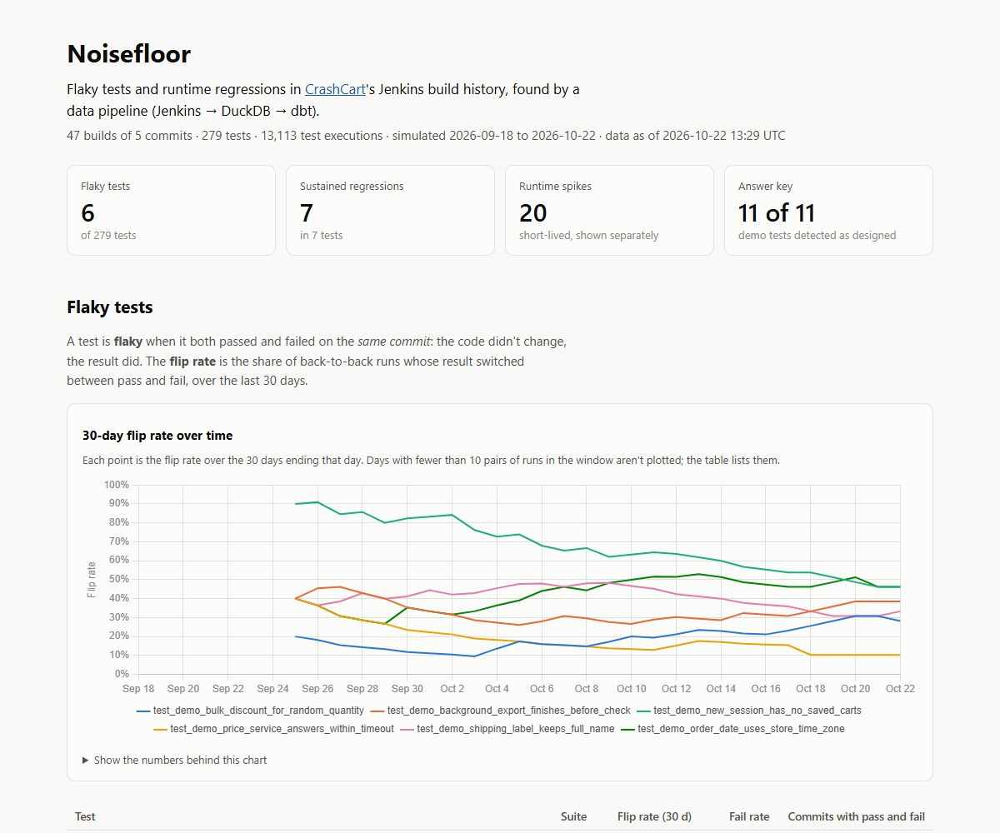
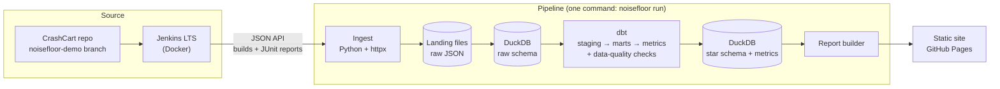
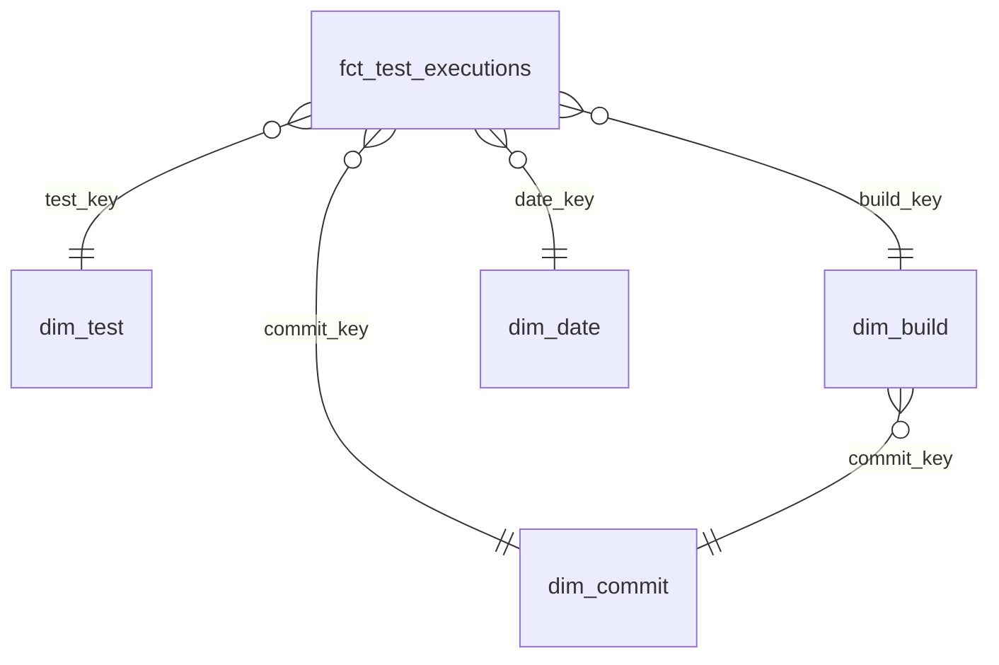

# Noisefloor

**A data pipeline that turns Jenkins build history into a star schema, to find flaky tests and
tests that got slower.**

[**Live report →**](https://kartikey3112.github.io/noise-floor/) &nbsp;·&nbsp;
[Decision log](docs/decisions.md) &nbsp;·&nbsp;
Data source: [CrashCart](https://github.com/kartikey3112/crash-cart/tree/noisefloor-demo)



## Why this exists

A test suite that fails now and then for no reason teaches people to ignore red builds. A test
that quietly gets five times slower makes every build slower. Both are hard to see one build at
a time and easy to see across many builds, which makes this a data problem.

Noisefloor reads every build from Jenkins, models the results in a star schema, and computes
three metrics:

| Metric | Plain meaning | Example |
|---|---|---|
| **Flaky (same-commit divergence)** | The test both passed and failed on the *same commit*: the code didn't change, the result did. | `test_x` passed on commit `abc123` in build 4 and failed on `abc123` in build 5, so it's flaky. |
| **30-day flip rate** | Of the test's back-to-back runs in the last 30 days, the share where the result switched between pass and fail. | Runs P, P, F, P: 2 switches in 3 pairs = 67%. |
| **Runtime regression** | A passed run that takes more than 1.5× the median of the test's previous 20 passed runs, **and** at least 0.5 s longer. Three or more in a row is *sustained*; fewer is a *spike* (timing noise). | Normally 0.20 s, now 1.23 s: 6×, +1.03 s, a regression. A 0.01 s test taking 0.40 s is 40× but only +0.39 s, so it isn't. |

A test's identity is `(suite, classname, test_name)`. Skipped runs are ignored by every metric.

## Results

The test data comes from a local Jenkins building [CrashCart](https://github.com/kartikey3112/crash-cart),
a small store app with real backend unit tests and API tests. A set of **demo tests** on its
`noisefloor-demo` branch is flaky or slow *on purpose*, with a published answer key
([`expected.json`](https://github.com/kartikey3112/crash-cart/blob/noisefloor-demo/tests/noisefloor_demo/expected.json)),
so the metrics can be checked against known right answers.

<!-- results:start (written by `noisefloor report`; don't edit by hand) -->

**Data:** 47 builds of 5 commits · 279 tests (133 unit, 135 API, 11 demo) · 13,113 test executions · simulated 2026-09-18 to 2026-10-22.

| Flaky tests | Sustained regressions | Runtime spikes | Answer key |
|---|---|---|---|
| **6** of 279 | **7** in 7 tests | **20** (one-off slow runs) | **11 of 11** demo tests detected as designed |

**Flaky tests**, by 30-day flip rate:

| Test | Suite | Flip rate (30 d) | Fail rate | Commits with pass and fail |
|---|---|---|---|---|
| `test_demo_new_session_has_no_saved_carts` | demo | 46% (18/39) | 43% (20/47) | 5 of 5 |
| `test_demo_order_date_uses_store_time_zone` | demo | 46% (18/39) | 23% (11/47) | 5 of 5 |
| `test_demo_background_export_finishes_before_check` | demo | 38% (15/39) | 19% (9/47) | 4 of 5 |
| `test_demo_shipping_label_keeps_full_name` | demo | 33% (13/39) | 23% (11/47) | 4 of 5 |
| `test_demo_bulk_discount_for_random_quantity` | demo | 28% (11/39) | 13% (6/47) | 5 of 5 |
| `test_demo_price_service_answers_within_timeout` | demo | 10% (4/39) | 8% (4/47) | 2 of 5 |

**Sustained regressions** (3 or more slow runs in a row):

| Test | Suite | Started | Normal → then | Slow runs in a row |
|---|---|---|---|---|
| `test_idempotency_keys_are_scoped_per_customer` | api | build #7, commit `f8da8bd` | 1.03 s → 1.80 s (1.74×) | 3 |
| `test_order_history_excludes_other_customers` | api | build #7, commit `f8da8bd` | 1.00 s → 1.64 s (1.64×) | 3 |
| `test_other_customers_order_is_404` | api | build #7, commit `f8da8bd` | 0.98 s → 2.18 s (2.23×) | 4 |
| `test_demo_order_history_page` | demo | build #17, commit `c869f4b` | 0.20 s → 1.23 s (6.04×) | 11 |
| `test_demo_product_search_repeats` | demo | build #25, commit `d1c62d1` | 0.29 s → 1.99 s (6.95×) | 11 |
| `test_demo_tax_rates_for_regions` | demo | build #33, commit `16d530c` | 0.20 s → 1.46 s (7.13×) | 11 |
| `test_demo_catalog_export_writes_every_row` | demo | build #41, commit `4331d0d` | 0.21 s → 1.38 s (6.48×) | 8 |

**Answer key** (demo tests only):

| Demo test | Designed as | Found | Match |
|---|---|---|---|
| `test_demo_background_export_finishes_before_check` | flaky, fails 20% of runs | flaky on 4 commits, fails 19% | ✓ |
| `test_demo_bulk_discount_for_random_quantity` | flaky, fails 15% of runs | flaky on 5 commits, fails 13% | ✓ |
| `test_demo_new_session_has_no_saved_carts` | flaky, fails 50% of runs | flaky on 5 commits, fails 43% | ✓ |
| `test_demo_order_date_uses_store_time_zone` | flaky, fails 23% of runs | flaky on 5 commits, fails 23% | ✓ |
| `test_demo_price_service_answers_within_timeout` | flaky, fails 10% of runs | flaky on 2 commits, fails 8% | ✓ |
| `test_demo_shipping_label_keeps_full_name` | flaky, fails 30% of runs | flaky on 4 commits, fails 23% | ✓ |
| `test_demo_catalog_export_writes_every_row` | slows down at `4331d0d` | slowed down at `4331d0d` | ✓ |
| `test_demo_order_history_page` | slows down at `c869f4b` | slowed down at `c869f4b` | ✓ |
| `test_demo_product_search_repeats` | slows down at `d1c62d1` | slowed down at `d1c62d1` | ✓ |
| `test_demo_tax_rates_for_regions` | slows down at `16d530c` | slowed down at `16d530c` | ✓ |
| `test_demo_saving_a_cart_keeps_it_for_later` | stable | stable | ✓ |

<!-- results:end -->

**What this shows:**

- Every demo test was detected as designed. Every slowdown was pinned to the exact commit that
  caused it, and none of the slow tests was mistaken for a flaky one.
- None of the real CrashCart tests is flaky. They're stable, which is the right answer too.
- The spikes are real API tests that were slow once. The API tests run 4 at a time on one
  laptop, so their timings are noisy. Rather than tune the rule until they disappear, the
  report labels them separately ([D-036](docs/decisions.md#d-036-runtime-spikes-versus-sustained-regressions)).
- The three real API tests listed as sustained regressions all started at the same build (#7),
  on the same commit as the fast builds just before it. The code didn't change, so the cause
  was the machine being busy for a few builds, not CrashCart. The star schema makes that quick
  to see: group the slow runs by build instead of by test.

Every number in the section above is written by the pipeline (`noisefloor report`), from the
same tables as the live report.

## Architecture



| Layer | Tool | Why |
|---|---|---|
| Source | Jenkins LTS in Docker, set up entirely from files (Configuration as Code) | the standard CI server; a fresh start needs no clicking |
| Ingestion | Python, `httpx` | incremental and idempotent: only new builds are fetched, and re-running never duplicates rows |
| Landing | raw JSON on disk | the raw tables can be rebuilt without asking Jenkins again |
| Warehouse | DuckDB | a single file, no server, fast window functions |
| Transform | dbt-core + dbt-duckdb | tested, documented SQL models |
| Report | static HTML + Chart.js on GitHub Pages | free, one click to open |

Everything is free and runs locally. The only hosted pieces are GitHub's free tier (the repo,
Actions to publish the site, and Pages). Nothing asks for a card.

## Data model



| Model | Grain (one row per…) | Notes |
|---|---|---|
| `fct_test_executions` | test execution: one test case in one build | outcome (pass / fail / skip), Jenkins status, duration, error, `test_run_seq` (the test's 1st, 2nd… run in time order) |
| `dim_test` | test `(suite, classname, test_name)` | the demo answer key joined in: what each demo test was designed to do |
| `dim_build` | Jenkins build | result, real and simulated start time |
| `dim_commit` | commit SHA | build order, subject, number of builds |
| `dim_date` | calendar day | for the flip-rate trend |
| `mart_same_commit_divergence` | test × commit | passes, fails, `is_divergent` |
| `mart_flip_rate_daily` | test × day | flips ÷ pairs over the 30 days ending that day |
| `mart_runtime_checks` | passed execution | baseline median, ratio, `is_regression` |
| `mart_runtime_regressions` | regression episode | where a slowdown started, how long it lasted, sustained or spike |
| `mart_test_health` | test | the summary the report reads |
| `mart_answer_key_check` | demo test | designed against detected |

The fact table holds `commit_key` directly, even though the build implies it, because the flaky
rule is literally "same test, same commit". Keys are MD5 hashes of the natural keys, so a full
rebuild never renumbers anything. Each model's SQL starts with its grain.

**About the timestamps.** All demo builds ran on one afternoon. To show the 30-day window
working, the newest build keeps its real time and each earlier build is placed 18 hours before
the next. The real time is kept alongside in `*_real_utc` columns, and the report says so.

## Quality

- **Unit tests for every metric** (dbt unit tests), on tiny hand-made datasets with known
  answers. For example: P, P, F, P must give a 2/3 flip rate, and a fast failure must not drag a
  test's baseline down. Run with a deliberately wrong threshold, the matching test fails.
- **Data-quality checks** run on every build:
  - uniqueness of every grain, including at most one execution per test per build
  - no nulls where they'd break a metric
  - referential integrity between raw tables and from the fact to every dimension
  - allowed values for statuses and outcomes
  - no negative durations
  - every completed build has test results
  - a warning if a suite suddenly loses results
  - freshness of the last ingestion

  Each was proven on a deliberately broken copy of the warehouse.
- **Python tests** (pytest) for parsing, incremental and idempotent ingestion, the pipeline
  runner, and the report's data embedding. Linted and formatted with ruff.

## Run it yourself

**You need:** Docker Desktop, Python 3.14, Git and [uv](https://docs.astral.sh/uv/). uv
installs Python 3.13 for the dbt step by itself.

```powershell
git clone https://github.com/kartikey3112/noise-floor.git
cd noise-floor
Copy-Item .env.example .env          # then set JENKINS_ADMIN_PASSWORD in .env

# 1. Start Jenkins (http://localhost:8080). The job is created automatically.
docker compose up -d --build

# 2. Create an API token: http://localhost:8080/user/admin/security
#    (API Token > Add new Token) and paste it into .env as JENKINS_API_TOKEN.

# 3. Build the demo history: 47 builds of 5 commits, about 50 minutes, unattended.
python scripts/generate_history.py

# 4. Install both environments, then run the whole pipeline.
uv sync
uv sync --project transform
uv run noisefloor run                 # ingest -> dbt build + checks -> freshness -> report

# 5. Open the report.
start site/index.html                 # macOS: open site/index.html
```

On macOS or Linux, use `cp .env.example .env` in place of `Copy-Item`.

Other commands:

| Command | What it does |
|---|---|
| `uv run noisefloor ingest` | fetch new finished builds (safe to run any time) |
| `uv run noisefloor reload-raw` | rebuild the raw tables from the landing files, without Jenkins |
| `uv run noisefloor transform` | `dbt build` only: models, unit tests, data-quality checks |
| `uv run noisefloor report` | rebuild `site/` and this README's results section |
| `uv run pytest` | the Python tests |
| `python scripts/export_demo_seeds.py --crashcart ../CrashCart` | refresh the answer-key seeds from a CrashCart clone |

The demo results are seeded from the Jenkins build number, so a fresh Jenkins should reproduce
the same flaky outcomes. Durations will differ slightly from machine to machine.

## Repository map

```text
noise-floor/
├── jenkins/              Dockerfile, pinned plugins, Configuration as Code, the job, Jenkinsfile
├── scripts/              build history on Jenkins; export the demo answer key as dbt seeds
├── src/noisefloor/       ingestion, raw layer, pipeline runner, report builder, CLI
├── transform/            dbt project (its own Python 3.13 environment)
│   ├── models/staging/       cleaned raw tables
│   ├── models/intermediate/  simulated build times
│   ├── models/marts/         the star schema
│   ├── models/metrics/       flakiness, flip rate, regressions, answer-key check
│   ├── seeds/                demo answer key and commit subjects
│   └── tests/                data-quality checks
├── tests/                Python tests
├── site/                 the published report (built by `noisefloor report`)
└── docs/decisions.md     every decision, the options considered, and why
```

## Honest limits

- **The demo tests are synthetic.** They exist so detection can be checked against known
  answers. The unit and API tests are real, but stable.
- **The timeline is simulated** (see above), and labelled everywhere it's used.
- **One Jenkins on one laptop.** Timings are noisy, and the report shows that noise as spikes
  rather than hiding it.
- **The report is rebuilt locally.** GitHub Actions can't reach a local Jenkins, so the site is
  built on the machine running Jenkins, then committed, and published by Actions.

Every choice above, and the alternatives it beat, is in [docs/decisions.md](docs/decisions.md).
